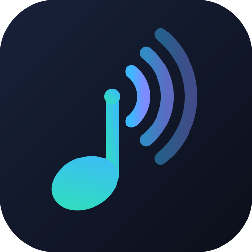
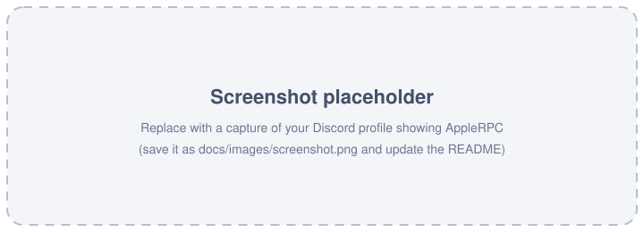

<p align="center">
  
</p>

<h1 align="center">AppleRPC</h1>

<p align="center">
  <b>Show what you're listening to on Apple Music as a Discord Rich Presence.</b><br>
  A tiny Windows tray app: no window, no fuss.
</p>

<p align="center">
  <a href="https://github.com/itzzNicholas/AppleRPC/actions/workflows/build.yml"></a>
  <a href="LICENSE"></a>
  
  
  <a href="https://github.com/itzzNicholas/AppleRPC/stargazers"></a>
</p>

<p align="center">
  
</p>

---

## What is it?

AppleRPC watches the **Apple Music app for Windows** and mirrors your current song to your Discord profile as a
*"Listening to …"* activity: song title, artist, album art, artist photo and a live progress bar.

It talks to the local Discord client over IPC (no bot, no token, no login) and reads the song from the
Windows media controls, so it works without touching Apple Music itself.

## Features

- 🎧 **"Listening to"** activity (not "Playing"), with the **song title shown in your status** in the member list
  (`status_display_type`).
- ⏱️ **Live progress bar** from start/end timestamps, recalculated after every seek, pause or skip.
- 🖼️ **Album cover** (large image) and **artist photo** (small image) with hover tooltips.
- 🔗 **Clickable text and images** (`details_url`, `state_url`, `large_url`, `small_url`) that open the
  song / artist / album on Apple Music.
- ⭐ A **"Star on GitHub"** button on your presence.
- ⚡ **Event-driven**: reacts to Windows media events instead of polling, and respects Discord's
  *one update every 15 seconds* limit (debounced, de-duplicated, latest-wins).
- ⏸️ **Pause handling**: the timer is removed on pause; the presence is cleared after a configurable delay.
- 🗂️ **Cover/photo caching** (memory + disk) with timeouts and retries, so it stays fast and polite to the public APIs.
- 🪶 **Lightweight tray app**: single instance, rotating log file, "Start with Windows" toggle, English or Italian menu.

## Requirements

- Windows 10 (2004 / build 19041) or Windows 11
- The **Apple Music** app for Windows (Microsoft Store version)
- The **Discord desktop app**, running as the same user (not "Run as administrator")
- [.NET 8 Desktop Runtime](https://dotnet.microsoft.com/download/dotnet/8.0) (x64) to run, or the **.NET 8 SDK** to build

## Setup

### 1. Create the Discord application (2 minutes)

Rich Presence needs an *application* on the Discord Developer Portal. Its **name is what Discord shows after
"Listening to"**, which is why it should be called **Apple Music**.

1. Open the [Discord Developer Portal](https://discord.com/developers/applications) and click **New Application**.
2. Name it **`Apple Music`**, accept the terms and click **Create**.
3. On **General Information**:
   - upload [`assets/logo-512.png`](assets/logo-512.png) as the **App Icon**;
   - copy the **Application ID**. It is public, not a secret.
4. Open **Rich Presence → Art Assets** and upload [`assets/logo-1024.png`](assets/logo-1024.png) with the key
   **`applerpc`**. It is the fallback image shown when no album cover can be found.
   (Discord recommends 1024×1024 and lower-cases asset keys. New assets can take a few minutes to appear.)

> You do **not** need a bot, OAuth2 redirect, client secret or any permission. Only the Application ID.

### 2. Get AppleRPC

**Download:** grab `AppleRPC-win-x64.zip` from the
[Releases](https://github.com/itzzNicholas/AppleRPC/releases) page or from the latest
[Actions](https://github.com/itzzNicholas/AppleRPC/actions/workflows/build.yml) run, and unzip it anywhere.

**Or build it yourself** (on Windows):

```powershell
git clone https://github.com/itzzNicholas/AppleRPC.git
cd AppleRPC
dotnet test                                   # optional: run the unit tests
dotnet publish src/AppleRPC/AppleRPC.csproj -c Release -r win-x64 --self-contained false -p:PublishSingleFile=true -o publish
```

or just open `AppleRPC.sln` in Visual Studio 2022 / Rider and run the **AppleRPC** project.

### 3. Configure

Open `appsettings.json` (next to `AppleRPC.exe`, or tray menu → **Apri configurazione / Open settings file**) and paste your ID:

```jsonc
{
  "DiscordApplicationId": "123456789012345678"
}
```

### 4. Run

Start `AppleRPC.exe`. A tray icon appears (check the "hidden icons" arrow ^ if you don't see it). Open Discord,
play something in Apple Music, and your profile updates within a few seconds. 🎶

### 5. Start automatically with Windows

Right-click the tray icon and toggle **Avvia con Windows / Start with Windows**. It writes a value under
`HKCU\Software\Microsoft\Windows\CurrentVersion\Run` (no admin rights needed). Toggle it again to remove it.
If you move the `.exe`, switch it off and on again so the path is updated.

## Configuration

All settings live in `appsettings.json` (comments allowed). Restart the app after editing.

| Setting | Default | Description |
|---|---|---|
| `DiscordApplicationId` | `""` | **Required.** Application ID from the Developer Portal. |
| `Language` | `"it"` | Tray menu language: `"it"` or `"en"`. |
| `StatusDisplayType` | `2` | What Discord shows in the status line: `0` app name · `1` artist · `2` song title. |
| `PauseClearAfterSeconds` | `120` | On pause the timer disappears; after this many seconds the presence is cleared. `0` = immediately, `-1` = never. |
| `MinUpdateIntervalSeconds` | `15` | Minimum time between presence updates (Discord's limit; values below 15 are raised to 15). |
| `ShowGitHubButton` | `true` | Show the "⭐ Star on GitHub" button. |
| `DefaultAsset` | `"applerpc"` | Art asset key used when no cover is found. |
| `AppleMusicSourceIds` | `["AppleMusic", "AppleInc.AppleMusicWin"]` | A media session is used if its app ID contains one of these (case-insensitive). |
| `Artwork.Enabled` | `true` | Look up covers/photos online. |
| `Artwork.ItunesCountry` | `"US"` | iTunes storefront used for the search (`"IT"`, `"GB"`, …). |
| `Artwork.UseArtistPhoto` | `true` | Fetch the artist photo from Deezer for the small image. |
| `Artwork.RequestTimeoutSeconds` / `MaxRetries` | `6` / `2` | Per-request timeout and retries (exponential backoff) for iTunes/Deezer. |
| `Artwork.LookupBudgetSeconds` | `8` | If a lookup is slower, the presence is shown without art first and refreshed when the art arrives. |
| `Artwork.CacheDays` | `30` | How long found covers/photos stay cached. |
| `Logging.Level` | `"Information"` | `Trace`, `Debug`, `Information`, `Warning`, `Error`. |
| `Logging.MaxFileSizeKB` / `MaxFiles` | `1024` / `3` | Simple log rotation (`applerpc.log`, `.1.log`, `.2.log`). |

Files are stored in `%LOCALAPPDATA%\AppleRPC\`: `logs\applerpc.log` and `artwork-cache.json`.

## How it works

```
 Apple Music ──► Windows media controls (SMTC)
                        │  events: song change · play/pause · seek
                        ▼
                  MediaWatcher ──► RpcCoordinator ──► ArtworkService ──► iTunes Search API (cover, links)
                                         │                          └──► Deezer API (artist photo)
                                         ▼
                                  ActivityBuilder
                                         ▼
                                  PresenceService ──► Discord IPC (\\.\pipe\discord-ipc-N)
                                  (debounce · dedupe · reconnect)
```

- **Reading the song.** `MediaWatcher` subscribes to `GlobalSystemMediaTransportControlsSessionManager`, picks the
  Apple Music session and reacts to its media/playback/timeline events (300 ms debounce). A slow 30 s safety check only
  recovers from a missed event and raises nothing unless something really changed. The Apple Music app sometimes puts
  `Artist — Album` in the artist field; AppleRPC splits it.
- **The progress bar.** Discord draws it from two timestamps. `start = now − position`,
  `end = start + duration`, with the position extrapolated from the last timeline update. A seek moves `start`,
  so it is detected and sent. Pausing removes the timestamps.
- **Rate limit.** Discord accepts one presence update per 15 s. `PresenceService` keeps only the *latest* desired
  state, waits out the interval, skips updates that would look identical (timestamp jitter is ignored) and
  re-sends after a reconnect. Skipping through five songs quickly results in a single update for the last one.
- **Artwork.** The cover comes from the [iTunes Search API](https://developer.apple.com/library/archive/documentation/AudioVideo/Conceptual/iTuneSearchAPI/)
  (`artworkUrl100` upscaled to `600x600`). The result that best matches title + artist + album wins. The artist
  photo comes from Deezer's public API (`picture_xl`, exact name match only, so you never get a stranger's face).
  If there is no photo, the album cover is used; if there is no cover, your `DefaultAsset`. Discord accepts external
  `https` image URLs directly in `large_image` / `small_image` and fetches them through its media proxy: no upload needed.
- **Discord IPC.** The app speaks the local IPC protocol directly (frames of `opcode · length · JSON`) instead of using
  a wrapper library, so it can use the newest activity fields (`status_display_type`, `*_url`).
  Discord not running? It keeps retrying quietly and shows the song as soon as Discord starts.

## Troubleshooting

| Problem | Things to check |
|---|---|
| **Nothing shows on Discord** | Is the Discord **desktop** app open (not the browser) and **not elevated**? Is *Display current activity* / activity sharing enabled in Discord's *User Settings → Activity Privacy*? Is `DiscordApplicationId` set (tray status says "Application ID missing" otherwise)? |
| **Tray says "Discord: error – Invalid Client ID"** | The Application ID is wrong. Copy it again from **General Information** (17–20 digits, no spaces). |
| **Tray stays on "Waiting for Apple Music…"** | Use the **Microsoft Store** Apple Music app and start playback. Check `AppleMusicSourceIds` and `logs\applerpc.log` (`Attached to media session '…'`). Set `Logging.Level` to `Debug` for more detail. The old iTunes app is not supported by default. |
| **"Listening to Apple Music" but my song isn't in the status** | `status_display_type` needs an up-to-date Discord client. Also check `StatusDisplayType` is `2`. |
| **I can't see my own button** | Normal: Discord hides your own Rich Presence buttons from you. Other people see them on desktop (mobile clients may not show buttons). Ask a friend or use an alt account to check. |
| **Wrong or missing cover** | Try another `Artwork.ItunesCountry` (some releases exist only in some storefronts). A "not found" result is cached for 24 h; delete `artwork-cache.json` to force a new lookup. |
| **Covers appear as the default logo** | You didn't upload the `applerpc` art asset (step 1.4), or it's still propagating. |
| **Progress bar is off by a few seconds** | The Apple Music app updates its timeline only on events. The bar is corrected on the next pause/seek/skip. |
| **Presence updates feel delayed** | That's Discord's 15 s limit; AppleRPC sends the newest state as soon as the interval allows. |
| **Antivirus / SmartScreen warning** | The exe is unsigned. Build it yourself if you prefer. |

Logs live in `%LOCALAPPDATA%\AppleRPC\logs` (tray menu → **Apri cartella log / Open log folder**). Please attach
the relevant lines when you [open an issue](https://github.com/itzzNicholas/AppleRPC/issues).

## Privacy

AppleRPC has no telemetry. To find artwork it sends **song title, artist and album** to the public iTunes Search API and
the **artist name** to Deezer's public API (set `Artwork.Enabled` to `false` to disable both). Discord receives your
presence like any other Rich Presence app. Everything stays on your PC otherwise.

## Roadmap

- [ ] Installer / MSIX package and winget manifest
- [ ] Optional "Listen on Apple Music" button that opens the current song
- [ ] Per-field customization of the presence text (templates)
- [ ] Tray icon reflecting state (playing / paused / disconnected)
- [ ] More UI languages
- [ ] Support for other players that expose Windows media controls
- [ ] Signed releases

Ideas and pull requests are welcome!

## Support the project

If AppleRPC makes your Discord a little more musical, please **[⭐ star the repository on GitHub](https://github.com/itzzNicholas/AppleRPC)**. It's free,
it takes one click, and it helps other people find the project. Bug reports, ideas and pull requests are just as appreciated. 💙

## License

AppleRPC is free software licensed under the **GNU Affero General Public License v3.0**. See [`LICENSE`](LICENSE).

## Disclaimer

AppleRPC is an independent, open-source project. It is **not affiliated with, endorsed by, or sponsored by Apple Inc.
or Discord Inc.** "Apple", "Apple Music" and "iTunes" are trademarks of Apple Inc.; "Discord" is a trademark of
Discord Inc. The AppleRPC logo is an original artwork and is not derived from any of their logos. The Discord application you
create is named "Apple Music" only so that Discord displays *"Listening to Apple Music"* on your own profile. Use AppleRPC at your own
risk and in accordance with the terms of the services it talks to.
